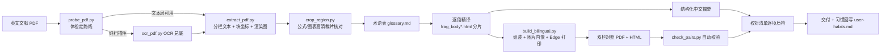

# Literature Fine Translation · 文献精细翻译

面向科研精读的英文文献**逐段精译** [WorkBuddy](https://www.workbuddy.cn) Skill。不是机器批量直译流水线，而是一套由 Agent 执行的完整工作流：**解析 → 核对 → 精译 → 双栏排版 → 结构化摘要 → 逐项质检**。

> 设计原则：译文由 Agent 直接产出，**不调用任何外部翻译 API / 翻译引擎**；公式与引文必须对照原始扫描页核对；术语全文统一并跨文献沉淀。

## 特性

- **逐段精译** —— 准确严谨优先，不增不删原文信息；长难句可拆分但逻辑关系保真
- **双栏对照排版** —— 左栏英文原文、右栏中文译文逐段配对；产出自包含 HTML 与 A4 PDF
- **术语一致** —— 术语与缩写译后括号保留原文（如「击穿判据（breakdown criterion）」）；`glossary.md` 跨文献累积
- **图形保真** —— 图片、曲线图、表格不翻译，按原位置以高清裁剪图嵌入；公式保留原编号
- **扫描件可靠** —— 文本层只作初稿；公式、上标引文、化学式强制对照扫描页核对（OCR 常丢符号）
- **可进化** —— 用户习惯记录进 `references/user-habits.md`，稳定条款上提 SKILL.md
- **结构化摘要** —— 背景目的 / 核心判据及物理机制 / 方法 / 关键参数与结论 / 适用条件与局限

## 快速开始

1. 把整个 `literature-fine-translation/` 目录复制到 WorkBuddy 用户 skill 目录：

   ```
   ~/.workbuddy/skills/literature-fine-translation/
   ```

2. 按 SKILL.md 的「环境依赖」表确认本机 Python（PyMuPDF）、Tesseract（可选）、Edge/Chrome 路径
3. 在 WorkBuddy 对话中给出英文文献 PDF 路径，说「精细翻译这篇文献」即可触发

## 工作流程



典型一次翻译会产出三个文件：

| 文件 | 说明 |
|---|---|
| `*双语对照.pdf` | 左英右中逐段配对，A4 打印版式 |
| `*双语对照.html` | 自包含源稿（图片已内嵌 base64），可继续编辑后重新出 PDF |
| `*结构化摘要.md` | 五条目结构化摘要，可直接用于文献综述 |

## 依赖

| 用途 | 组件 | 备注 |
|---|---|---|
| PDF 解析与图形裁剪 | Python 3.10+ / PyMuPDF | `pip install pymupdf` |
| 扫描件 OCR 兜底 | Tesseract ≥ 5 | 可选；纯扫描 PDF 走 `get_textpage_ocr` |
| HTML → PDF | Edge 或 Chrome | 无头打印，路径填入 SKILL.md 环境表 |

## 目录结构

```
literature-fine-translation/
├── SKILL.md                  # 工作流、翻译硬约束、校对清单、环境依赖
├── scripts/                  # 工具箱六件套
│   ├── probe_pdf.py          # 体检：文本层/分栏/图片 → 定处理路线
│   ├── extract_pdf.py        # 分栏文本块 + 坐标 JSON + 整页渲染图
│   ├── crop_region.py        # 按坐标裁高清区域（公式/图表核对）
│   ├── ocr_pdf.py            # 纯扫描件 OCR 兑底（Tesseract）
│   ├── build_bilingual.py    # 分片组装 + 图片内嵌 base64 + 无头打印 PDF
│   ├── check_pairs.py        # 交付前校验（配对/标签/图片/公式连续）
└── references/
    ├── glossary.md           # 术语表（英文 | 中文 | 缩写 | 备注），随使用积累
    └── user-habits.md        # 用户习惯进化日志（空模板起步）
```

## 自定义与进化

- **术语**：翻译中登记新术语到 `references/glossary.md`，同一术语全文、跨文献统一
- **习惯**：用户新要求写入 `references/user-habits.md`（带日期）；反复出现的稳定条款上提 SKILL.md
- **版式**：分片命名约定 `frag_head.html`（CSS + 标题区）/ `frag_body*.html`（正文）/ `frag_tail.html`，改样式只需动 `frag_head`

## 隐私与版权说明

- `user-habits.md` 与 `glossary.md` 属于个人使用积累，**分享或公开仓库时请重置为模板**
- 示例输出不随仓库分发：对照译文包含受版权保护的源文献文本，请仅在个人科研精读范围内使用

## License

[MIT](LICENSE)
